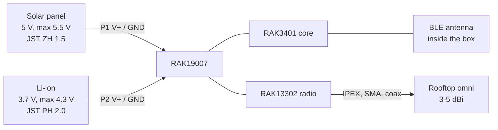

# Cheap MeshCore Rooftop Repeater

Solar-battery MeshCore repeater built on the battery-powered RAK WisMesh 1 W kit (RAK3401 + RAK13302 + RAK19007). Parts total $116 before shipping and tax.

This is the battery-powered RAK13302. The power amplifier is fed by a trace on the RAK19007, so the roof harness has no separate 5 V lead. Current kits are sold as two different modules, battery-powered or external 5 V, and they are not interchangeable.

## Parts

| Part | What to buy | About |
| --- | --- | --- |
| Radio | WisMesh 1W starter kit, battery powered, your band | $39 |
| Battery | Protected 3.7 V Li-ion, 5000 mAh, JST-PH 2.0, at least 1.5 A discharge | $12 |
| Panel | 5 V, about 5 W. Open-circuit voltage at or under 5.5 V | $15 |
| Antenna | Outdoor fiberglass omni for that band, 3–5 dBi | $20 |
| Box | Light-colored IP65 ABS, about 150 × 110 × 70 mm | $12 |
| RF exit | SMA bulkhead and a short pigtail from the module IPEX | $10 |
| Hardware | Cable gland, small heatsink, strap, screws | $8 |
| **Total** | | **$116** |

The kit already includes a rubber-duck antenna, BLE antenna, USB cable, IPEX-to-SMA lead, and screws. The duck is for the bench. The roof antenna is a separate part.

## Wiring

Three cables leave the boards. The BLE pigtail stays inside the enclosure.

| Cable | Connector | Lands on | Rating |
| --- | --- | --- | --- |
| Solar | JST ZH 1.5 mm, 2 pin | P1 | 5 V, 5.5 V maximum |
| Battery | JST PH 2.0 mm, 2 pin | P2 | 3.7 V nominal, 4.3 V maximum |
| LoRa | IPEX pigtail, then SMA coax | RAK13302 to the omni | Center and shield |
| BLE | IPEX pigtail | RAK3401 | Stays in the enclosure |

Match each conductor to the V+ and V− silk on that jack. On the usual RAK battery lead, red is V+.

The RAK19007 solar input absolute maximum is 5.5 V, and the ZH jack is about 1 A, so a 5 V panel of about 5 W is the match. A panel sold as 6 V or 12 V will exceed that input. One protected 3.7 V cell goes to P2. Do not put cells in series.

USB-C is the bench port. It flashes the board and can charge at up to 350 mA. It does not run the 1 W stage by itself.

Hook up the antenna first, then the battery, then the panel.

## Power

Sizing estimates for a quiet repeater:

| | |
| --- | --- |
| Idle | on the order of 15 mA |
| Design average | 25 mA at 3.7 V, about 2.2 Wh/day |
| 5000 mAh pack | about 15 Wh usable, roughly 6–7 days with no sun |
| 5 W panel | enough energy in a sunny climate at a couple of full-sun hours |

Face the panel south in the northern hemisphere, tilted near your latitude, and put the box in its shade. A measured transmit on the external-5 V path is about 820–850 mA at 5 V for roughly 275 ms. The cell supplies that pulse.

## Roof box

- SMA bulkhead on the bottom or lower side, with a drip loop. Keep outdoor coax under about 3 m of LMR-240 or similar.
- One cable gland for the panel leads, and a small vent so the box can breathe.
- A small aluminum heatsink on the booster. A light-colored box in the panel's shade is the cooling.
- Strap the cell so it cannot touch the PA.
- Bond the mast to the building ground if one exists. That bond stays on the mast hardware and does not land on P1 or P2.

## Firmware

Flash from [flasher.meshcore.io](https://flasher.meshcore.io) over USB-C with the battery connected:

- Device: RAK WisMesh 1W Booster (3401 + 13302)
- Role: Repeater
- Preset: your region
- Set the repeater admin password before it goes on the roof

A repeater is administered from another MeshCore companion, over the mesh. Set the name, location, and transmit power there. Leave the advert interval at the default.

## Transmit power

The hardware can reach 30 dBm. Set MeshCore transmit power to whatever the grant on your module and your local rules allow, and use a modest 3–5 dBi omni. In the EU, unlicensed 868 MHz is far below 1 W, and a plain RAK4631 is the cheaper legal repeater there.
