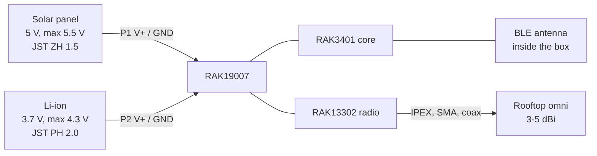

# Cheap MeshCore Rooftop Repeater

Solar-battery MeshCore repeater built on the battery-powered RAK WisMesh 1 W kit (RAK3401 + RAK13302 + RAK19007). Sourced parts are $138.93. With the published US shipping and a 7.53% average combined sales tax, the total is $149.39. Atlavox and Wireless Haven still add whatever delivery their checkout quotes.

This is the battery-powered RAK13302. The power amplifier is fed by a trace on the RAK19007, so the roof harness has no separate 5 V lead. Current kits are sold as two different modules, battery-powered or external 5 V, and they are not interchangeable.

## Parts

Prices were read on 17 November 2026. The radio is the US915 battery-powered kit. The antenna is N-male, so the roof pigtail is an N-female bulkhead to an SMA male, which mates with the IPEX-to-SMA lead in the kit.

| Part | Listing | Price |
| --- | --- | --- |
| Radio | [Rokland WisMesh High Power Booster, battery powered, SKU 116256](https://store.rokland.com/products/wismesh-high-power-booster-starter-kit-with-nrf52840-sx1262-and-sky66122-pa-for-extended-meshtastic-range) | $49.97 |
| Battery | [Winfox 3.7 V 5000 mAh, JST-PH 2.0, protected](https://www.amazon.com/Winfox-Rechargeable-Connector-Bluetooth-Portable/dp/B0GDQG4DYT) | $13.99 |
| Panel | [Atlavox 5 W ETFE, JST ZHR-2](https://atlavox.com/products/solar-panel-5w). Sold out. Listed as 5–6 V | $16.99 |
| Antenna | [Bingfu 915 MHz 3 dBi fiberglass, N-male](https://www.amazon.com/dp/B09GVP14NS) | $29.99 |
| Box | [Aexit IP65 ABS, 150 × 110 × 70 mm, with cable gland](https://www.amazon.com/Aexit-Accessories-Waterproof-Uninterrupted-150x110x70mm/dp/B07L6BQH6Z) | $13.20 |
| RF exit | [Wireless Haven N-female bulkhead to SMA male, 6 inch](https://thewirelesshaven.com/product-category/cables/pigtail-cables/sma-pigtails/) | $6.20 |
| Heatsink | [uxcell 15 × 11 × 5 mm adhesive aluminum, 20 pack](https://www.amazon.com/uxcell-15x11x5mm-Adhesive-Aluminum-Electronics/dp/B093TY94GK) | $8.59 |
| **Parts** | | **$138.93** |
| Shipping | Rokland US orders of $20 or more ship free. This radio order is $49.97 | $0.00 |
| Shipping | Atlavox and Wireless Haven calculate delivery at checkout. Those two fees are not in the total | — |
| Tax | 7.53% of the parts. Population-weighted US state and local average, Tax Foundation, July 2026. A local rate will differ | $10.46 |
| **Total** | Parts, published shipping, and that tax | **$149.39** |

The kit already includes a rubber-duck antenna, BLE antenna, USB cable, IPEX-to-SMA lead, and screws. The duck is for the bench. The roof antenna is the Bingfu line above. The box listing includes the cable gland and mounting screws.

## Wiring

Three cables leave the boards. The BLE pigtail stays inside the enclosure.

| Cable | Connector | Lands on | Rating |
| --- | --- | --- | --- |
| Solar | JST ZH 1.5 mm, 2 pin | P1 | 5 V, 5.5 V maximum |
| Battery | JST PH 2.0 mm, 2 pin | P2 | 3.7 V nominal, 4.3 V maximum |
| LoRa | IPEX pigtail, then SMA coax | RAK13302 to the omni | Center and shield |
| BLE | IPEX pigtail | RAK3401 | Stays in the enclosure |

Match each conductor to the V+ and V− silk on that jack. On the usual RAK battery lead, red is V+.

The RAK19007 solar input absolute maximum is 5.5 V, and the ZH jack is about 1 A, so a 5 V panel of about 5 W is the match. A panel sold as 6 V or 12 V will exceed that input. One protected 3.7 V cell goes to P2. Do not put cells in series.

USB-C is the bench port. It flashes the board and can charge at up to 350 mA. It does not run the 1 W stage by itself.

Hook up the antenna first, then the battery, then the panel.

## Power

Sizing estimates for a quiet repeater:

| | |
| --- | --- |
| Idle | on the order of 15 mA |
| Design average | 25 mA at 3.7 V, about 2.2 Wh/day |
| 5000 mAh pack | about 15 Wh usable, roughly 6–7 days with no sun |
| 5 W panel | enough energy in a sunny climate at a couple of full-sun hours |

Face the panel south in the northern hemisphere, tilted near your latitude, and put the box in its shade. A measured transmit on the external-5 V path is about 820–850 mA at 5 V for roughly 275 ms. The cell supplies that pulse.

## Roof box

- SMA bulkhead on the bottom or lower side, with a drip loop. Keep outdoor coax under about 3 m of LMR-240 or similar.
- One cable gland for the panel leads, and a small vent so the box can breathe.
- A small aluminum heatsink on the booster. A light-colored box in the panel's shade is the cooling.
- Strap the cell so it cannot touch the PA.
- Bond the mast to the building ground if one exists. That bond stays on the mast hardware and does not land on P1 or P2.

## Firmware

Flash from [flasher.meshcore.io](https://flasher.meshcore.io) over USB-C with the battery connected:

- Device: RAK WisMesh 1W Booster (3401 + 13302)
- Role: Repeater
- Preset: your region
- Set the repeater admin password before it goes on the roof

A repeater is administered from another MeshCore companion, over the mesh. Set the name, location, and transmit power there. Leave the advert interval at the default.

## Transmit power

The hardware can reach 30 dBm. Set MeshCore transmit power to whatever the grant on your module and your local rules allow, and use a modest 3–5 dBi omni. In the EU, unlicensed 868 MHz is far below 1 W, and a plain RAK4631 is the cheaper legal repeater there.
